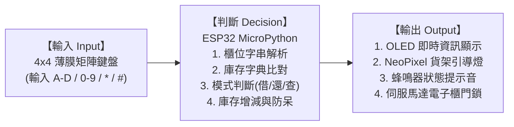
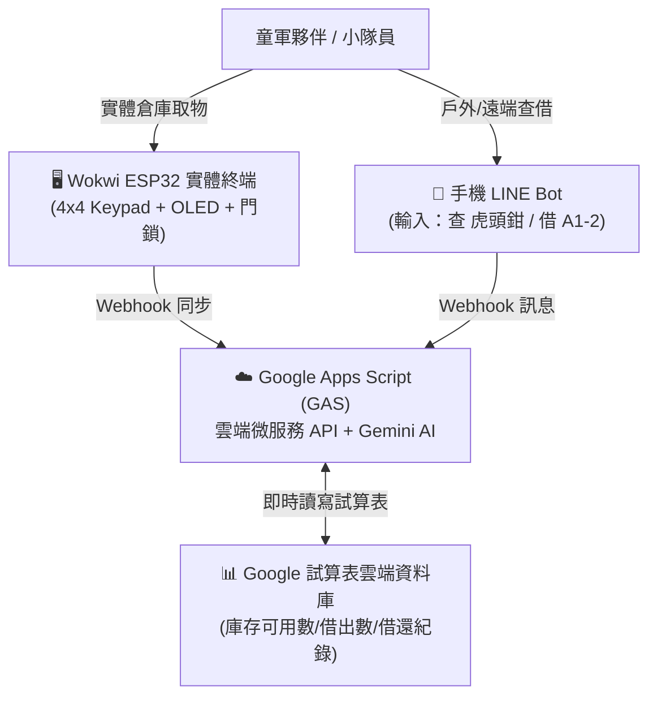

# 童軍倉庫智慧櫃位引導與借還終端機 (Scout Smart Locker System)

> **智慧生活物聯網實作 × 倉儲資產管理系統**  
> 一個基於 **ESP32 + MicroPython** 的邊緣計算智慧倉儲終端，實現童軍器材借還、庫存即時盤點與智慧貨架光引導（Pick-to-Light）。

---

## 📌 專案背景與痛點解決

在童軍團集會、露營與戶外活動中，團部庫房存放成百上千種器材（童軍繩、營釘、卡式爐、帳篷、急救箱、工程模型等）。長久以來面臨三大痛點：
1. **櫃位凌亂、昏暗難找**：裝備箱層疊堆放，昏暗倉庫中找特定器材（如 `A1-2` 虎頭鉗或 `B3-4` 營燈）極費時間。
2. **借還無即時登記**：活動忙碌時常有借無還，活動結束才發現重要工具短缺，無法即時究責。
3. **帳物不符與超額借出**：器材借完時無防呆機制，導致其他小隊撲空。

### 💡 解決方案
本系統透過邊緣硬體終端：
- **4×4 矩陣薄膜按鍵（未教過零件）**：直覺輸入櫃位代碼與切換「借出 / 歸還 / 查詢」模式。
- **I2C OLED 螢幕 (SSD1306)**：即時顯示器材名稱、規格單位與當前可用庫存量。
- **NeoPixel RGB 燈條 (Pick-to-Light)**：依輸入的櫃位分區點亮貨架引導燈（A櫃亮藍、B櫃亮綠、C櫃亮黃、D櫃亮紫），黑暗中一目了然。
- **蜂鳴器 (Passive Buzzer)**：提供按鍵反饋音、操作成功音階與缺貨警示音。
- **伺服馬達 (Servo Motor)**：模擬智慧櫃門電子鎖，成功借出/歸還時自動解鎖 90 度，3 秒後自動復位上鎖。

---

## 🏗️ 系統架構（輸入 ➔ 判斷 ➔ 輸出）

本系統為嚴格之閉環狀態機，支援無限次重複操作，永不終止：



---

## 🔌 硬體配置與接線表 (Pin Mapping)

| 零件名稱 | 零件角色 / 說明 | ESP32 接腳 | 備註 |
| :--- | :--- | :--- | :--- |
| **4×4 矩陣按鍵** | **課堂未教過零件**（輸入櫃位代碼與模式） | Row: `19, 18, 5, 17`<br>Col: `16, 4, 0, 2` | 矩陣動態掃描 (Debounce 防彈跳) |
| **0.96吋 OLED 螢幕** | 資訊輸出（顯示品名、庫存、提示） | SDA: `GPIO 21`<br>SCL: `GPIO 22` | I2C 協定 (0x3C) |
| **NeoPixel RGB 燈條** | 智慧尋架燈（Pick-to-Light 引導） | DIN: `GPIO 15` | WS2812 8顆 RGB |
| **被動蜂鳴器** | 聽覺提示（成功音階、缺貨警報） | Pin 1: `GPIO 12`<br>Pin 2: `GND` | PWM 音頻控制 |
| **伺服馬達 (SG90)** | 電子櫃門鎖（核准時旋轉開鎖） | PWM: `GPIO 13`<br>V+: `5V` / GND: `GND` | 50Hz PWM 控制角度 (0°~90°) |

---

## 📋 櫃位編碼規則與內建器材清單

系統嚴格遵照童軍庫房邏輯編碼：
- **英文字母**：櫃位名稱（A 櫃：繩索與五金工具 / B 櫃：炊事與露營裝備 / C 櫃：廚房食器 / D 櫃：手工藝與活動耗材）
- **字母後數字**：第幾排（架/層）
- **負號後數字**：該排第幾個儲物箱

| 櫃位代碼 | 簡碼輸入 | 器材名稱 | 單位 | 預設庫存 | NeoPixel 指引燈色 |
| :--- | :--- | :--- | :--- | :--- | :--- |
| **A1-1** | `A11#` 或 `A1#` | 光繩 (Glow Rope) | 條 | 15 | 藍光 (LED 0-1) |
| **A1-2** | `A12#` | 虎頭鉗五金工具組 | 支 | 4 | 藍光 (LED 0-1) |
| **A1-7** | `A17#` | 粗童軍繩 | 條 | 42 | 藍光 (LED 0-1) |
| **B3-1** | `B31#` | 卡式瓦斯爐 | 個 | 1 | 綠光 (LED 2-3) |
| **B3-4** | `B34#` | 露營營燈 | 個 | 2 | 綠光 (LED 2-3) |
| **B3-6** | `B36#` | 削皮刀/料理小刀 | 支 | 14 | 綠光 (LED 2-3) |
| **C1-1** | `C11#` | 料理廚具砧板組 | 個 | 5 | 黃光 (LED 4-5) |
| **D2-7** | `D27#` | 無線對講機 (Walkie Talkie) | 台 | 4 | 紫光 (LED 6-7) |

---

## 🕹️ 終端機按鍵操作說明

- **`*` 鍵（星號）**：切換模式（**BORROW 借出** ➔ **RETURN 歸還** ➔ **QUERY 查詢** 循環切換）。
- **`A` ~ `D` 鍵**：輸入櫃位字母。**按下當下即刻點亮對應貨架引導燈！**
- **`0` ~ `9` 鍵**：輸入排號與箱號（例如要借 `A1-2`，依序按下 `A` `1` `2`）。
- **`#` 鍵（井號）**：確認送出（Enter）。
  - 若為 **BORROW 模式**：庫存充足時扣除 1，鳴響成功音，全條跑馬燈流水綠光，伺服馬達轉動 90 度開鎖！若庫存為 0，鳴響長短警報，全條閃爍紅光防呆！
  - 若為 **RETURN 模式**：庫存加 1，伺服馬達解鎖方便歸位，3秒後自動鎖定。
  - 若為 **QUERY 模式**：OLED 顯示該櫃器材品名與即時剩餘庫存。
- **`D` 鍵（獨立用途）**：在輸入中途可充當清除鍵（Clear），清除輸入緩衝區。

---

## 🚀 Wokwi 快速執行指南

1. 前往 [Wokwi.com](https://wokwi.com)，建立一個 **ESP32 + MicroPython** 專案。
2. 將本專案的 `diagram.json` 內容完整替換至 Wokwi 的 `diagram.json` 標籤頁。
3. 將本專案的 `main.py` 內容完整複製貼上至 Wokwi 的 `main.py`。
4. 點擊 Wokwi 上方的綠色執行按鈕 **▶ (Start Simulation)**。
5. 看到 OLED 顯示迎賓畫面，按鍵即可開始模擬操作！

---

## ☁️ 雲端延伸：LINE Bot 智慧管家與 Google 試算表即時連動

本專案除了線下 Wokwi ESP32 實體終端，更具備 **「雲端雙軌連動 (Dual-Track Cloud Sync)」** 架構：



### 📱 LINE Bot 常用操作指令：
1. **查庫存**：
   - `查 虎頭鉗` 或 `查 A1-2` ➔ 即時回報品名、櫃位位置、現存可用數與狀態。
   - `缺貨清單` ➔ 一鍵列出目前全數被借出、庫存為 0 的所有器材。
2. **登記借出與歸還（直接更動試算表）**：
   - `借 虎頭鉗` 或 `借出 A1-2 1` ➔ 試算表可用數 -1，借出數 +1，並自動新增一筆借用人與時間紀錄！
   - `還 虎頭鉗` 或 `歸還 A1-2 1` ➔ 試算表可用數 +1，借出數 -1，歸還入庫。
3. **童軍知識與裝備諮詢**：
   - 任意輸入露營、生火、繩結等問題，由內建 Google Gemini AI 提供專業童軍指引。

---

## 📁 檔案結構說明

```text
├── main.py                          # ESP32 MicroPython 主程式 (含狀態機與各零件驅動)
├── diagram.json                     # Wokwi 電路圖與零件腳位配置
├── README.md                        # 專案完整技術文件
└── docs/
    ├── AI_DEVELOPMENT_SUMMARY.md    # 與 AI 協同開發過程摘要 (作業繳交附件)
    ├── PROJECT_REPORT.md            # 專題完整期中報告 (做什麼/給誰用/怎麼做/怎麼測/下一步)
    └── SLIDES_AND_90S_SCRIPT.md     # 90 秒上台演示逐字稿 + 期中簡報投影片文案
```
